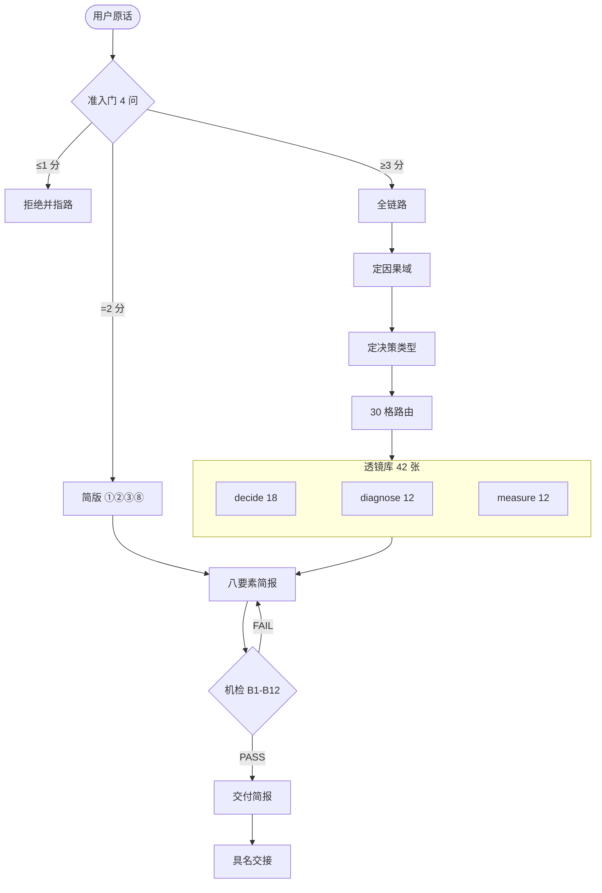
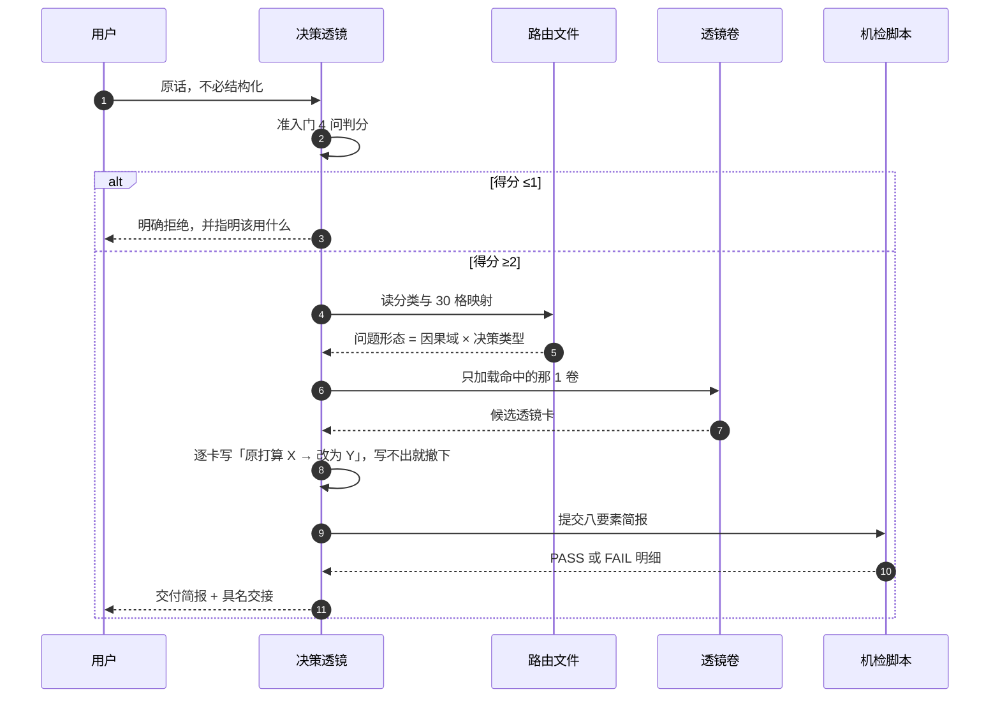

<div align="center">

<h1>决策透镜 · decision-lens</h1>

<p>面对模糊、高杠杆、多约束、长期影响的难题时，先用认知透镜重构问题，再下判断</p>

<p>
  
  
  
  
</p>

</div>

> **一句话定位**：你拿不准一件事时，缺的往往不是更多信息，而是**看这件事的角度**。本技能先判断这个决定值不值得这样想一遍，再从 42 张透镜里挑出 **1 到 3 个**真正能改变你决定的，逼你把「原打算怎么做 → 改为怎么做」写出来，最后指明下一步交给哪个具名能力。

> **先看边界**：一次最多 3 个透镜；**选 0 个说明这个问题不该走本流程**，技能会明确拒绝并告诉你该用什么。机检守的是**结构**（八要素齐全、字段非占位、证伪条件存在），**守不了「分类对不对、结论好不好」**——实测有简报用错透镜却通过全部 12 条机检，详见[机检守不了什么](#机检守不了什么)。

## 目录

- [这是什么](#这是什么)
- [能力地图](#能力地图)
- [一次提问怎么走](#一次提问怎么走)
- [八步主链路](#八步主链路)
- [透镜库](#透镜库)
- [机检体系](#机检体系)
- [机检守不了什么](#机检守不了什么)
- [三条设计纪律](#三条设计纪律)
- [快速开始](#快速开始)
- [目录结构](#目录结构)
- [本仓含什么](#本仓含什么)
- [行尾前提](#行尾前提)
- [运行环境](#运行环境)
- [版本与迭代](#版本与迭代)
- [引用与署名](#引用与署名)
- [边界与免责](#边界与免责)

## 这是什么

一个遵循通用 `SKILL.md` 约定（YAML frontmatter ＋ Markdown 正文）的认知透镜路由技能，装进支持该约定的智能体平台即可用自然语言提问。

它做四件事：**判断值不值得想**（4 问准入门，≤1 分直接拒绝并指路）、**给问题定位**（因果域 × 决策类型 = 30 格）、**只挑 1–3 个能改变决定的透镜**（42 张里路由，不是全过一遍）、**出稿前跑机检**（12 条判据，非 0 退出码不许出稿）。

| 你问 | 简报里会出现什么 |
|---|---|
| “这个功能要不要现在做？” | 准入门判分后落到 complicated × 是否做，典型命中 D-13 存在性判据：先指认下一次具体交付在哪一步调用它，指认不出就不做 |
| “两个方案结果差不多，选哪个？” | 落到 clear × 取舍，典型命中 D-16：结果判等时取简的一侧——不比谁更漂亮，比谁的维护面更小 |
| “上线后指标掉了，是工具的问题还是源数据的问题？” | 落到 clear × 归因，典型命中 P-11：先分工具缺陷与来源缺陷，别在错的那一层上找原因 |
| “指标降了 30%，能说明这次改动有效吗？” | 落到 complex × 归因，典型命中 M-03：净贡献须配对消融，没有对照组就不算归因 |
| “做到什么程度可以停？” | 落到 clear × 边界，典型命中 M-09：门禁要有量化放行阈值，否则“差不多”永远说不清 |
| “我完全不知道该从哪问起” | 命中 disorder——本技能最高价值场景：先分类，并把**分类结论本身**当作一条隐含假设写出来 |

> 输出是**八要素推理架构简报**：原始问题与被掩盖的问题 / 隐含假设 / 选中的透镜及理由 / 每个透镜改变了哪个决策 / 非显然推论 / 反例与失败条件 / 适用边界 / 下一步交给谁。

不接管的事各有专责，**以 `SKILL.md` 的「本技能不做什么」为唯一定义点**，本文件不重复列表。

## 能力地图



三层职责：**准入门**拦掉不该走本流程的问题（避免把简单查询包装成深度思考）；**路由**把问题压到一格、只加载命中的那一卷（42 张不全读）；**机检**在出口卡结构与边界（不为漂亮话放行）。

## 一次提问怎么走



一次典型运行只加载 **3 个文件**（路由 ＋ 1 卷 ＋ 交接表），实测 **465–574 行**，而不是把 42 张全读一遍。

## 八步主链路

| 步 | 做什么 | 产物或闸门 |
|---|---|---|
| S0 | 准入门 4 问：模糊 / 高杠杆 / 多约束 / 长期，各 0 或 1 分 | ≥3 分全链路 ｜ =2 分简版 ｜ ≤1 分拒绝并指路 |
| S1 | 二维定位：因果域（clear / complicated / complex / chaotic / disorder）× 决策类型（选型 / 取舍 / 归因 / 边界 / 时序 / 是否做） | 落一格；命中 disorder 必须先分类 |
| S2 | 4 个固定探针挖隐含假设：谁定义的 / 什么被当作给定 / 什么被当成指标 / 时间尺度默认多长 | 要素② |
| S3 | 按 30 格取候选 → 去同族重复 → 按决策增量排序 → 取 Top-3 → 逐个试填 | 最终保留 1–3 个 |
| S4 | 逐透镜产出 4 件：改变了哪个决策 / 非显然推论 / 什么证据会推翻 / 何时不该用 | 要素④ |
| S5 | pre-mortem 三步：假设六个月后已失败 → 倒推至少 3 个原因 → 每条标来源 | 要素⑥ |
| S6 | 整体边界 ＋ 每个透镜的「何时不该用」 | 要素⑦ |
| S7 | 落到具名能力 ＋ 触发条件 ＋ 验证判据 | 要素⑧ |
| S8 | 出稿前跑机检，退出码非 0 不许出稿 | 0 全过 ｜ 1 有 FAIL ｜ 2 用法错 |

> Q2「高杠杆」不靠感觉：挂 Meadows 12 级杠杆阶梯，判据是「这个判断落在 #1–#5 还是 #9–#12」。低层不得分。

## 透镜库

42 张卡按决策类型分三卷，**每张卡 6 个字段一次写全**，其中「改变了哪个决策」必须含转折、「什么证据会推翻」与「何时不该用」不得留空或占位，填不出即撤下该透镜。

| 卷 | 张数 | 覆盖决策类型 | 代表卡 |
|---|---|---|---|
| `references/lens-decide.md` | 18 | 选型 / 取舍 / 是否做 | D-13 外部工具引入的存在性判据 · D-16 结果判等时取简的一侧 · D-05 信任与闸门按「可逆性 × 可机验性」分层 |
| `references/lens-diagnose.md` | 12 | 归因 / 边界与停止 | P-11 先分工具缺陷与来源缺陷 · P-08 结构一致性可外包、内容质量不能 · M-07 异常读数先溯源 |
| `references/lens-measure.md` | 12 | 度量与验证 | M-03 净贡献须配对消融 · M-06 引用分数先审口径 · M-12 机制上线前过双门槛 |

路由不是拍脑袋：30 格映射表（5 因果域 × 6 决策类型）每格预登记 2–3 张，机检要求**空格数为 0、僵尸透镜为 0**。此外有 8 个同族互斥组（同组最多选 1）和 4 条防无差别套用机制：

| 机制 | 堵住的逃逸口 | 机检 |
|---|---|---|
| M1 预算硬约束 | 数量：把 42 张都过一遍 | B3 |
| M2 决策增量绑定 | 质量：选了却说不出改变了什么 | B5 |
| M3 同族互斥 | 冗余：同组透镜换着说法重复 | B8 |
| M4 反向闸门 | 沉默：只写选了什么，不写为什么没选别的 | B7 |

> 全量套用的本质是「每张都能说上两句，但没有一张真正改变决策」。四条机制分别卡数量、质量、冗余、沉默。

## 机检体系

`scripts/check_lens_brief.py` 只认一个判定对象：本技能产出的八要素简报。**发现 0 个检查对象即 FAIL，不许静默通过。**

| 编号 | 判据 |
|---|---|
| B1 | 输入非空且 ≥ 200 字符，否则判零命中 FAIL |
| B2 | ①–⑧ 八要素全部命中且正文非空；一个都不命中 → 零命中 FAIL |
| B3 | 已选透镜数 ∈ [1,3]（0 = 不该走本流程；≥4 = 无差别套用） |
| B4 | 每个被选透镜含「什么证据会推翻」且非占位 |
| B5 | 每个被选透镜的「改变了哪个决策」含转折标记 |
| B6 | 每个被选透镜含「何时不该用」，边界密度 100% |
| B7 | 弃用记录 ≥ 2 条且理由非空（反向闸门） |
| B8 | 已选透镜按 8 个互斥组去重后数量不变 |
| B9 | 要素⑥条目 ≥ 1 且每条标注来源（pre-mortem / 反例 / 边界） |
| B10 | 要素⑧落到具名能力，不含「继续分析」类空话 |
| B11 | 全文无 TODO / 待补 / XXX 类占位 |
| B12 | 全文无盘符 / 家目录 / UNC 路径 |

判据本身也要被证明有效，所以脚本自带**缺陷注入自检**：合法样本必须零误报，12 个注入缺陷必须全部被捕获，缺一不算通过。完整输出（原样摘录）：

```
[OK]   合法样本零误报（1968 字符）
[OK]   M01 清空全文→B1 → 捕获 B1
[OK]   M02 删第⑦要素→B2 → 捕获 B2
[OK]   M03 透镜加到4个→B3 → 捕获 B3
[OK]   M04 删证伪条件→B4 → 捕获 B4
[OK]   M05 决策增量改复述→B5 → 捕获 B5
[OK]   M06 删何时不该用→B6 → 捕获 B6
[OK]   M07 删弃用记录→B7 → 捕获 B7
[OK]   M08 换成同族透镜→B8 → 捕获 B8
[OK]   M09 删反例条目→B9 → 捕获 B9
[OK]   M10 交接改空话→B10 → 捕获 B10
[OK]   M11 插入 TODO→B11 → 捕获 B11
[OK]   M12 插入本机路径→B12 → 捕获 B12
[OK]   目录自检：30 格无空格、无僵尸透镜

SELFTEST PASS
```

```bash
python scripts/check_lens_brief.py <简报.md>      # 校验一份简报
python scripts/check_lens_brief.py --stdin < b.md # 从 stdin 读
python scripts/check_lens_brief.py --selftest     # 缺陷注入自检（改判据后必跑）
python scripts/check_lens_brief.py --check-catalog # 校验 30 格映射表
```

退出码对齐容器主线：`0` 无 FAIL ｜ `1` 有 FAIL（含零命中）｜ `2` 用法或配置错误。**零命中归 1 不归 2**——文件存在但读不到简报内容，是检查跑了并判出 FAIL；只有「根本没跑起来」才配 2。

## 机检守不了什么

这是本技能已知的边界，写在前面比藏在后面好。

实测过一份**故意用错透镜**的简报：把故障态误判成建设期，得出「趁故障窗口整体重建」的结论——明显更差，但**它通过了全部 12 条机检**。

这不是 bug，是判据的作用域：B1–B12 守结构（八要素齐全、字段非占位、证伪条件存在），守不了「分类对不对、结论好不好」。内容质量要走独立评审——这也正是 P-08 那张透镜说的：结构一致性可外包，内容质量不能。

同理，机检也不判断**透镜是否被正确理解**。一张卡用对了名字、用错了判据，机检照样放行。

## 三条设计纪律

1. **没有决策增量的透镜一律撤下。** 写不出「原打算 X → 改为 Y」，说明它只是换个说法复述你已知的东西。
2. **边界密度 100%。** 每张卡都必须写「何时不该用」，没有例外。
3. **诚实账优先。** 来源是公开的就标 `[公开] <URL>`，是自撰的就标 `[自撰]`——三卷 42 张里 `[自撰]` 占多数，如实交代，不把自撰标成公开。

## 快速开始


1. 下载或克隆：

   ```bash
   git clone https://github.com/eiway112/decision-lens.git
   ```

2. 把整个 `decision-lens/` 目录复制到你所用平台的技能加载目录。WorkBuddy 的加载目录是个人目录下的 `.workbuddy/skills/`；其他平台以其文档为准。**目录名保持 `decision-lens`**，须与 `SKILL.md` 的 `name` 一致。
3. 重启平台，直接提问，例如：“这个功能要不要现在做？我拿不准。”
4. 想让机检也起作用，装好 Python 3 后在仓库根目录跑一次 `--selftest`，确认判据在你的机器上确实能抓到缺陷；再用 `references/worked-example.md` 当合法样本，确认不误报。

## 目录结构

```
decision-lens/
├── SKILL.md                          ← 主链路 S0-S8 · 八要素模板 · 加载索引
├── README.md / LICENSE / CHANGELOG.md
├── .gitattributes / .gitignore
├── references/
│   ├── forms-and-routing.md          ← 分类 + 30 格映射表 + 8 互斥组（每次必读）
│   ├── lens-decide.md                ← 18 张：选型 / 取舍 / 是否做
│   ├── lens-diagnose.md              ← 12 张：归因 / 边界与停止
│   ├── lens-measure.md               ← 12 张：度量与验证
│   ├── falsification-patterns.md     ← 「什么证据会推翻」写不出来时读
│   ├── handoff-map.md                ← 要素⑧交接表
│   ├── worked-example.md             ← 完整样例（兼 selftest 合法样本）
│   └── sources.md                    ← 公开来源清单 + 脱敏规则
└── scripts/
    └── check_lens_brief.py           ← B1-B12 机检 + 缺陷注入自检 + 目录自检
```

## 本仓含什么

本仓即完整技能，共 15 个文件：根级 6 个（`SKILL.md`、`README.md`、`LICENSE`、`CHANGELOG.md`、`.gitattributes`、`.gitignore`）、`references/` 8 个、`scripts/` 1 个。

| 类别 | 随包 | 不随包 |
|---|---|---|
| 技能本体 | `SKILL.md` ＋ 三件套 ＋ 行尾与忽略配置，6 个 | — |
| 判定资料 | `references/` 8 个（三卷透镜 ＋ 路由 ＋ 交接 ＋ 样例 ＋ 来源） | 透镜库的原始素材底稿（含未脱敏出处与逐字引文） |
| 机检 | `scripts/check_lens_brief.py` 1 个 | — |
| 过程记录 | — | 裁撤条目的仓外留存件、发布与核验记录 |

> 42 张卡由一批实践素材裁减而来，**裁撤的条目不在本仓**；三卷末尾保留了「未入选条目」表，只列标题与一句裁撤理由，已脱敏，可公开审计。

## 行尾前提

仓根 `.gitattributes` 声明 `* text=auto eol=lf`，请保留。若你的机器设了 `core.autocrlf=true`（Windows 上常见，且可能来自全局配置），删掉或绕过该文件会让克隆后的工作树整体转成 CRLF，与文件内部记录的字节形态不一致。自验法：`git ls-files --eol` 中文本件应落 `i/lf`。

## 运行环境

技能本体是纯文本资产，复制即用，无运行依赖。机检脚本只用 Python 标准库（`argparse` / `re` / `os` / `sys` / `io`），无第三方依赖；最低要求 Python 3.7（用到 `sys.stdout.reconfigure`），未使用 3.8 之后的新语法。

## 版本与迭代

- 版本号单一定义在 `SKILL.md` 的 `version`，必须与同名 git tag 对齐；`v1.0.0` 为首发。本文件不复述具体版本号，避免升版时两处不一致。**版本号只写在文件里而没有对应 tag，使用者就无法在 git 层锁定内容。**
- tag 一律轻量（`git tag vX.Y.Z`），不用 `git tag -a`。
- 定级：新增或撤换透镜卡 = MINOR；判据口径变更、改变已有简报通过结果 = MAJOR 或 MINOR；文案勘误 = PATCH。变更记录见 [CHANGELOG.md](CHANGELOG.md)。
- 反馈与纠错欢迎开 Issue：用错的透镜、写不出的证伪条件、判据误伤合法简报，都算有效反馈。

## 引用与署名

本仓库采用 [MIT License](LICENSE)。复制、引用或二次开发请保留版权声明；建议引用格式：

> 决策透镜（decision-lens）vX.Y.Z，eiway112，https://github.com/eiway112/decision-lens

## 边界与免责

- 透镜是**思维工具**，不产出事实性结论，也不替代专业判断。「什么证据会推翻」这一栏需要你自己去取证。
- 简报的结论强度，取决于输入的完整度与分类的准确度；分类错了，后面每一步都跟着错，机检不会替你发现。
- 涉及法律、财务、医疗、工程安全等后果的决策，请交由相应专业人员复核，本技能的输出只作讨论素材。
